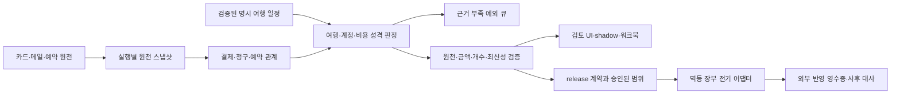

# 비용처리 파이프라인 점검과 개선 설계

점검 기준일: 2026-09-07. 구현·통합 검증일: 2026-09-08. 범위는 이 저장소의 로컬 코드·보존 산출물·테스트와 Google Workspace 연결 확인이다. 운영 Apps Script의 배포 코드, 트리거, 외부 예약앱의 실행 상태까지 검증한 것은 아니다.

구현 결과와 재현 명령은 [최신 인계](handoff/2026-09-08/README.md)에 기록한다. 아래 실측은 수정 전부터 보존된 산출물에 대한 결과이며, 수정된 코드로 그 산출물을 다시 생성했다는 뜻은 아니다.

## 목표와 완료 기준

목표는 **전 기간의 실제 결제·환불·비현금 비용을 빠짐없이 보존하고, 확인된 예약과 명시 여행 일정에 따라 여행별 비용을 설명할 수 있게 만드는 것**이다. 사용자는 근거가 부족한 예외만 검토하고, 같은 확정 결과가 워크북과 장부에 반영되어야 한다.

완료 기준은 행수나 자동 분류율 하나가 아니다.

- 결제 원행 identity·부호·통화·정확금액 보존, 이벤트 누락·증폭·중복 0건.
- 예약·청구·취소·환불의 독립 원천 연결. 결제일·가맹점 이름만으로 여행이나 예약번호를 생성하지 않음.
- 여행 귀속·계정·비용 성격의 독립 검증. 표시 후보와 전기 가능 상태를 구별함.
- 원천·규칙·스키마·산출물 해시가 같은 실행을 가리킴. 오래된 감사표를 최신 DB에 적용하지 않음.
- 사용자 지정 양식의 보존과 거래별 대조. 미확정 건을 기타비용·과년도 종결로 숨기지 않음.
- 외부 전기는 별도 release 조건, 멱등키, 원격 반영 결과 확인을 모두 만족함.

## 범위별 점검

| 흐름 | 현재 진입점 | 판단과 개선 |
|---|---|---|
| 카드 정규화·레거시 원장 | `ledger/ingest.py`, `link_workbook.py` | 감사·재현 경로로 명시. 현행 도메인 결과와 별도 정본처럼 경쟁하지 않게 함 |
| 직접 원천·분류·배분 | `ledger/domain/direct_sources.py`, `direct_projection.py` | 기존 모듈을 공통 계산 경로로 사용. 새로운 별도 분류 엔진은 만들지 않음 |
| 여행 일정 | `direct_trip_schedule_authority.py`, `direct_verified_ota_lodging.py` | JSON 형태 검증과 원천 payload 검증 경로가 갈라짐. 공통 권위 로더·종료일 의미 계약 필요 |
| 메일·Agoda 수집 | `agoda_mail_import.py`, `tools/agoda_paseo_batch_import.py` | 원문·수집 범위·해시를 고정. Agoda는 전용 Paseo IAB 세션 규칙 유지 |
| OTA 관계 후보 | `tools/build_agoda_card_link_candidate.py` | 현재 DB와 8월 26일 감사표가 불일치. 새 감사표를 임의로 붙이는 대신 원천부터 재현해야 함 |
| OTA 회계 초안 | `tools/build_ota_extended_draft_v4.py` | `proposed` 링크와 일정 일치를 `bound_unique`로 표현. 관계·여행·release 권위를 분리해야 함 |
| 회계 shadow | `tools/build_agoda_journal_shadow_v5_ota.py` | 음수의 절댓값 변환을 재현. 금액 부호 보존·입력 감사 결속·안전한 출력 생성이 최우선 |
| 비용 워크북 | `tools/build_cost_yangsik_v15_rev3.py` | 행수·총액은 보존. 여행·예약번호·증빙·이용기간은 근거 없이 다시 생성하므로 최종 회계자료로 수용할 수 없음 |
| 검토 UI·이벤트 원장 | `webapp/` | 로컬 shadow 검토와 snapshot 검증을 재사용. UI 확인을 외부 전기 권한으로 취급하지 않음 |
| Apps Script 전기·메일 수집 | `apps-script/Code.gs`, `GmailIngest.gs` | 출발일+7일 분류가 남음. 공통 계산 결과를 소비하는 어댑터로 전환 필요 |
| 입금 동기화·PIN·주간 보고 | `LeaderPaymentSync.gs`, `PinLinks.gs`, `WeeklyReport.gs` | 외부 쓰기·메일 발송 포함. 주간 보고는 폐지된 `_C` 탭 집계를 계속 사용. 운영 배포와 분리해 정리 |

## 확인된 주요 문제

### 1. 차변·대변 균형이 금액 정확성을 보장하지 않는다

수정 전 v5 shadow 빌더의 `build_batches_and_lines()`는 `abs(int(row["amount_krw"]))`를 사용했다. 9월 8일 수정안은 양수 구매만 받아들이며 음수·0원·금액의 임의 형 변환을 거부한다.

| 항목 | 실측 |
|---|---:|
| 초안 행수 / 서로 다른 payment_id | 113 / 113 |
| 초안 signed 합계 | 27,879,494원 |
| 초안 음수 행수 / 합계 | 11 / −5,207,800원 |
| 기존 shadow batches / lines | 113 / 226 |
| 기존 shadow 차변 / 대변 | 각 38,295,094원 |
| 원래 부호와 달라진 행 | 11건 |
| signed 초안과 shadow 합계 차이 | 10,415,600원 |

현재 schema는 양수 구매용이다. 독립 취소·환불 연결 없이 음수를 양수 비용으로 만들거나, 임의 역분개하거나, 조용히 누락하면 안 된다. 음수·0원은 별도 lifecycle 경로가 필요하다는 오류로 중단해야 한다. 기존 DB는 증거로 보존한다.

### 2. v15는 데이터 보존과 의미 정확성이 다르다

로컬 워크북은 29개 시트, 5,328행, 합계 708,722,467원이며 후보 DB의 전체 결제 행수·합계와 같다. 음수 443행도 남아 있다. 지출 헤더는 `거래일자 / 항목 / 내용 / 기간 / 예약번호 / 증빙유형 / 금액(원)`이다.

그러나 빌더는 다음 값을 새로 추론한다.

- 여행: `occurred_on`이 기간에 포함되는 첫 일정. 미매칭 2025년은 종결, 나머지는 기타비용.
- 내용: 가맹점 문자열로 분류. Trip.com·KLOOK 등을 일괄 숙박으로 처리할 수 있음.
- 기간: 실제 예약기간 대신 여행 전체기간 또는 `2025_종결`을 채움.
- 예약번호: `가맹점 앞 10자_결제일`을 생성. 실제 예약번호가 아님.
- 증빙유형: 가맹점의 JP/TOKYO 등 문자열로 영수증, 나머지는 국민으로 표시. 실제 카드사 원천을 쓰지 않음.

워크북 실측 증빙 표시는 국민 3,873행·영수증 1,455행뿐이다. 형태가 일치해도 이 값들이 원천에서 검증되었다는 뜻은 아니다. 새 출력은 검증된 결과를 복사하고, 알 수 없는 예약번호·숙박 이용기간은 공란으로 남겨야 한다.

### 3. 감사표와 DB가 같은 실행을 나타내지 않는다

후보 DB의 현재 SHA-256은 `c42a889da60fdb8f9e06a966c726609bb459d861591f1ccfacf8e3b6c97507eb`이다. 연결 감사표의 `outputs.database_sha256`은 `5b0c91970b15bb55fc6474b4cde9bf44f2b5522cc9959bf33c9fb4290f36b0eb`이다.

현재 링크는 104개, 상태는 전부 `proposed`다. 과거 감사표는 `payment_booking_links=0`을 기록한다. 초안 감사표도 현재 후보 DB와 다른 `input_database_sha256`을 참조하고, 초안 자체를 검증할 최종 `database_sha256`이 없다. 수정 전 shadow 로더는 그 해시가 없으면 검증을 생략했다. 수정안은 해시 누락·불일치, 행수·부호 있는 합계 불일치, 입력 변경을 오류로 처리한다.

따라서 보존 DB의 구조 무결성 `ok`를 원천 계보·분류 정확성의 성공으로 취급할 수 없다.

### 4. 일정 경계의 구현·사용자 지시·테스트가 어긋난다

권위 문서는 48행 중 authoritative 47행, candidate_only 1행이다. `load_document()`는 JSON 필드와 digest 형식을 검사하지만 locator의 원천 바이트를 검증하지 않는다. 반면 DB의 `load_authoritative_trip_schedule()`은 payload digest를 재검증한다.

수정 전 DB 로더의 `exclusive_service_end` 분기는 `period.last_service_on`을 사용하여 하루를 뺐다. 9월 8일 수정안은 최신 사용자 지시에 따라 정규화된 여행 `ends_on`에 원천 종료일을 그대로 보존한다. 숙박 마지막 밤을 나타내는 `last_service_on` 계산은 별도로 유지한다. 연도 경계·잘못된 기간·원천 digest 변조를 합성 자료로 검증했다.

또한 현재 일반 tie-break 구현과 기존 복수 일정 충돌 테스트가 서로 다르다. 사용자 확인된 경계 사례를 명시한 계약과 일반 충돌 보류를 함께 정리해야 하며, 실패 테스트를 삭제해서 해결하면 안 된다.

### 5. 운영 주변 기능과 문서가 뒤처져 있다

- `WeeklyReport.gs`는 `_C` 탭만 집계하지만 현행 전기 설명은 실 여행탭이다.
- `LeaderPaymentSync.gs`는 탭의 MMDD·지역으로 예약앱 여행을 찾는다. 연도·안정 여행 ID 검증이 필요하다.
- 9월 1일 인계는 9월 2~3일 정정을 포함하지만 `LOG.md`, 비용 규칙 원장, README의 오래된 설명이 남아 있다.
- 외부 로그 DB 삭제는 디스크 관리 작업이다. 비용 산출물의 증거 완전성이나 전기 허용 조건과 결합하면 안 된다.
- Google Sheets 읽기를 실제 호출했으나 커넥터 credentials 파일 부재로 실패했다. 과거 OAuth 완료 기록만으로 현재 세션 접근 성공을 주장하지 않는다.

## 목표 구조

실행마다 `run_id`, 입력 manifest, 코드/규칙/스키마 버전, 집계, 예외 큐, 검증 보고서, 산출물 해시를 같은 디렉터리에 보관한다. 이전 실행을 덮어쓰지 않고, 의존 입력 해시가 달라진 단계부터 다시 실행한다. 원천 엑셀은 실행당 한 번만 파싱하고 종료 시에는 바이트 해시만 확인한다.

기존 `transition_gates_v2.py`의 `shadow_ready`와 `release_ready` 분리를 유지한다. 새 진단 명령은 구조·파일 상태를 알려주는 도구이며 release 승인자가 아니다.

## 개선 순서와 수용 조건

| 순서 | 작업 | 수용 조건 |
|---|---|---|
| P0 | 읽기 전용 통합 진단 명령과 파이프라인 목록 | 누락·변조·오래된 감사·전기 flag 위반을 구분, 입력 DB 불변, 민감 행 출력 없음 |
| P0 | v5 shadow의 음수 변환·감사 생략·덮어쓰기 수정 | 음수·0원 중단, 입력 해시 결속, 원금 보존, 출력 충돌/실패 시 기존 파일 보존 |
| P1 | 일정 정규화·겹침 계약 단일화 | 종료일 보존, 승인된 특례만 적용, 일반 충돌 보류, 원천 digest 변조 음성 테스트 |
| P1 | OTA 초안을 정식 관계·분류 경로에 통합 | proposed/held가 자동 확정으로 승격되지 않음, 개별·그룹·lifecycle 별도 검증 |
| P1 | 워크북을 결과 투영기로 교체 | 원천 identity와 행별 대조, 실제 예약번호·카드사·기간만 출력, 양식 복제, 합계 재계산 |
| P2 | Apps Script를 검증 결과 소비자로 전환 | 결제일 분류 제거, 현재 run/release 검증, 중복 전기 방지·원격 반영 결과 대사 |
| P2 | 보고·입금 동기화·문서 정리 | 실탭/안정 여행 ID 사용, dry-run 검증, 외부 발송은 승인 범위에서만 실행 |

P1/P2는 잘못된 현재 결과를 새 정본으로 승격하는 작업이 아니다. 먼저 원천·일정 계약과 테스트 불일치를 해소하고, 현행 산출물을 새 실행에서 재현한 뒤 그 결과를 수용해야 한다. 외부 서비스 자격증명 복구와 운영 배포 확인은 별도 조건이다.

이번에 반영하는 범위는 P0 두 항목과 P1의 종료일 정규화다. OTA 초안과 워크북의 전체 교체는 검증된 관계·일정 원천을 기준으로 재현해야 한다. 지금 보존된 초안에 최종 해시만 사후 기입하거나, 일반 일정 충돌에 새로운 우선순위를 만들어 이 조건을 우회하지 않는다.

후속 구현은 다음 입력과 출력 계약으로 나눈다.

- **원천 재현:** 원본 카드·예약·명시 일정과 각 digest를 실행 manifest에 고정한다. 후보 링크 104개를 독립 관계 검증에 통과한 링크와 검토 대기로 구분한다.
- **판정 재사용:** 결제 identity별로 관계 상태, 여행 권위, 비용 성격, 실제 서비스 기간, 실제 예약번호, 원천 증빙 종류를 보관한다. `proposed`, `held`, 결제 연도만으로 최종 귀속을 만들지 않는다.
- **워크북 투영:** 위 판정 결과를 사용자 지정 양식에 옮긴다. 알 수 없는 예약번호와 숙박·렌트 기간은 공란으로 두고, 전체 결제의 행별 identity·부호·금액 대조표를 함께 만든다.
- **전기와 보고:** Apps Script는 같은 실행의 검증된 판정만 소비한다. 원격 장부와 보고도 그 실행 ID와 안정 여행 ID를 참조하고, 이전에 반영된 이벤트는 다시 쓰지 않는다.

## 토큰을 적게 쓰는 운영

사용자가 재개 시 구현 모델을 **`codex/gpt-reserve`, `thinkingOptionId=max`**로 변경했다. 실제 Paseo 모델 목록 확인 후 격리 작업공간에서 호출했다. 앞선 Luna 작업은 미완성 후보로 보존하여 재사용한다.

- 계획·근거 확인은 코디네이터가 한 번 수행한다. 작은 구현 명세에는 수정 파일·금지 범위·완료 조건·관련 테스트만 전달한다.
- 구현 에이전트에게 대화 전체·원장·메일을 반복 전달하지 않는다. synthetic fixture와 코드 의존성만 사용한다.
- 정상 경로는 결정론적 코드로 처리한다. LLM은 새 원천 형식과 예외 해석의 후보 생성에만 쓴다.
- 코드 변경과 관계없는 5,328행 전체검사를 매 단계 반복하지 않는다. 변경 테스트 후 최종 집계를 한 번 확인한다.
- 모델별 실제 토큰 사용량이 반환되지 않으면 추정치를 실측처럼 보고하지 않는다. 품질·지연·재작업량과 함께 기록한다.

## 검증 기록

- 기존 테스트 824개 수집. 전체 실행은 45초 제한으로 `test_domain_ledger.py::test_change_log_is_idempotent_and_rebuilds_current_state`에서 종료. 전체 통과로 볼 수 없다.
- 일정·OTA 권위·webapp 대상 실행: **42 passed, 1 failed**. 실패는 `test_two_explicit_overlapping_periods_are_ambiguous`와 현재 tie-break 동작의 충돌이다.
- 로컬 보존 DB 4개를 SQLite 읽기 전용으로 열어 `quick_check=ok` 및 집계를 확인했다.
- 워크북은 읽기 전용으로 전수 행수·금액·헤더를 확인했다. 수식의 LibreOffice 재계산·시각 양식 대조를 이번에 완료한 것으로 표시하지 않는다.
- 9월 8일 최종 통합 실행은 **102 passed, 1 failed, 16 skipped, 경고 0건**이다. 실패는 위에서 확인한 기존 일정 겹침 건이며, Python 363개·Apps Script 5개의 문법 검사도 통과했다.
- 최종 읽기 전용 진단은 10단계 중 구조 검사 통과 7, 오류 1, 미검증 1, 외부 실행 생략 1로 기록했다. 후보 감사 해시 불일치로 전체 상태는 `blocked`다. DB 4개와 워크북 1개의 원본 해시를 보존했다.
- [최신 인계](handoff/2026-09-08/README.md)에 재현 명령과 해시를 보존했다. 기존 문제를 숨기기 위한 baseline 변경·테스트 삭제·운영 DB 갱신은 하지 않았다.
